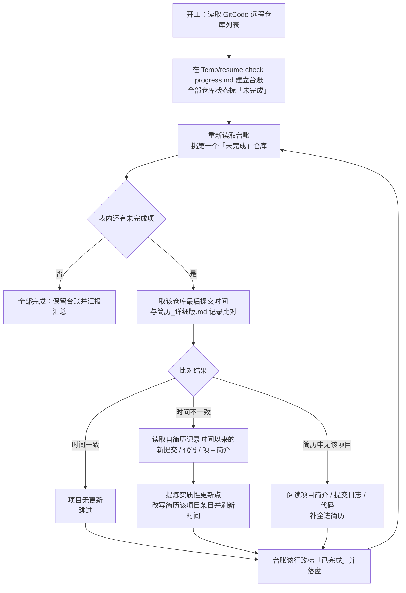

使用 GitCode 的两个 MCP 插件读取我的远程仓库：

1. 先统计共有多少个仓库，并列出仓库列表。
2. 然后逐个仓库处理，**一次只处理一个仓库**。

针对每个仓库：

- 先取该仓库的最后提交时间，与本地 `F:\BaiduSyncdisk\ZhengEnCi\Note\Resume\简历_详细版.md` 中记录的该项目时间比对。
- 若时间一致 → 说明项目无更新，跳过即可。
- 若时间不一致（简历已记录该项目，但记录时间与仓库最后提交时间对不上）→ **完整同步**：读取自简历记录时间以来的新提交 / 代码 / 项目简介，提炼出对简历有价值的**实质性更新点**，据此改写该项目在 `简历_详细版.md` 中的条目，并把时间刷新为仓库的最新提交时间。
- 若 `简历_详细版.md` 中**没有**该项目 → 阅读该项目的相关信息（项目简介、提交日志、项目代码等），据此帮我把该项目补全进 `简历_详细版.md`。

注意：**一次只能针对一个项目**，处理完一个再处理下一个。
目标文件：`F:\BaiduSyncdisk\ZhengEnCi\Note\Resume\简历_详细版.md`。

处理流程如下：



---

## 进度台账（Progress Ledger）🧠

> 目的：仓库数量多、逐个处理会反复读取大量信息，**上下文极易被压缩甚至冲掉状态**。因此必须把进度落到磁盘文件上，**不依赖上下文记忆**。

**台账文件**：`F:\BaiduSyncdisk\ZhengEnCi\Note\Resume\Temp\resume-check-progress.md`（该目录不纳入版本控制）

### 规则

1. **开工先建台账**：列出全部仓库，每行一条，字段为 `仓库名 | 最后提交时间 | 简历中是否已含 | 状态`，**状态初始全部标「未完成」**。
2. **一次只处理一个**：每轮只挑台账中第一个「未完成」的仓库处理。
3. **处理完立刻回写**：把该行状态改标「已完成」，**随改随落盘**，不得攒着一起写。
4. **下一轮先重读**：处理下一个仓库前，**必须重新读取 `Temp\resume-check-progress.md`**，据此确定进度与下一个目标 —— 严禁只凭上下文记忆推进。
5. **中断可续跑**：若 `Temp\resume-check-progress.md` 已存在（例如上次会话中断），**直接读取并从未完成项继续**，不得从头重来。
6. **收尾**：全部标为「已完成」后保留台账供我核对，并汇报汇总（共几个仓库、更新了哪些、跳过了哪些）。

---

## 简历项目条目字段规范（写入 `简历_详细版.md` 的统一模板）📐

> 参照 STAR 法则（Situation 情境 / Task 任务 / Action 行动 / Result 结果），并结合现有条目的实际结构，`简历_详细版.md` 中每个项目条目统一按以下 **5 段式**书写：

```markdown
### {项目名} | {起止时间}

**项目背景**：{为什么做——委托方 / 立项缘由 / 解决什么问题}（S）

**个人角色**：{我负责什么——独立开发 / 负责哪些模块 / 团队分工}（T）

**技术栈**：{核心技术栈，用 + 连接}

**项目成果**：（A + R，3~6 条，量化指标加粗）
- **{成果标题}**：{做了什么 + 达到什么效果（尽量量化）}
- ...
- **开源代码**：GitHub/Gitee/GitCode（{开源范围}）｜ **项目链接**：{URL}
```

### 写作要求

1. **每项目 3~6 条成果**，突出与目标岗位相关的部分，不写「负责 XXX 功能」式流水账。
2. **关键成果加粗**（用 `**` 包裹），尽量带量化数字（响应时间 / 耗时 / 精度 / 效率提升）。
3. **项目背景 / 个人角色各一句话**，不铺陈。
4. **时间以仓库最后提交时间为准**；`开源代码` 与 `项目链接` 视实际有无酌情保留。
